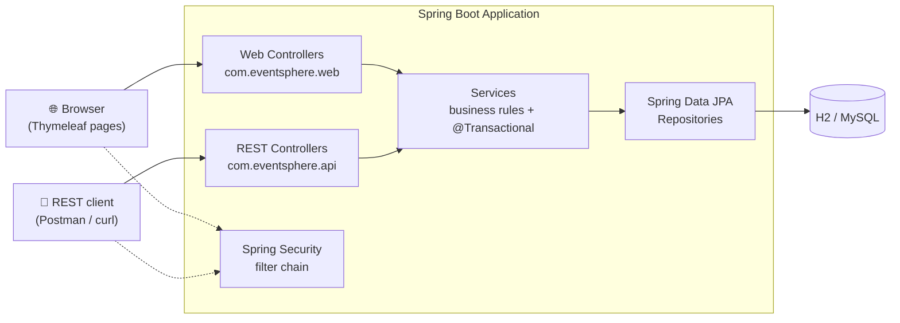
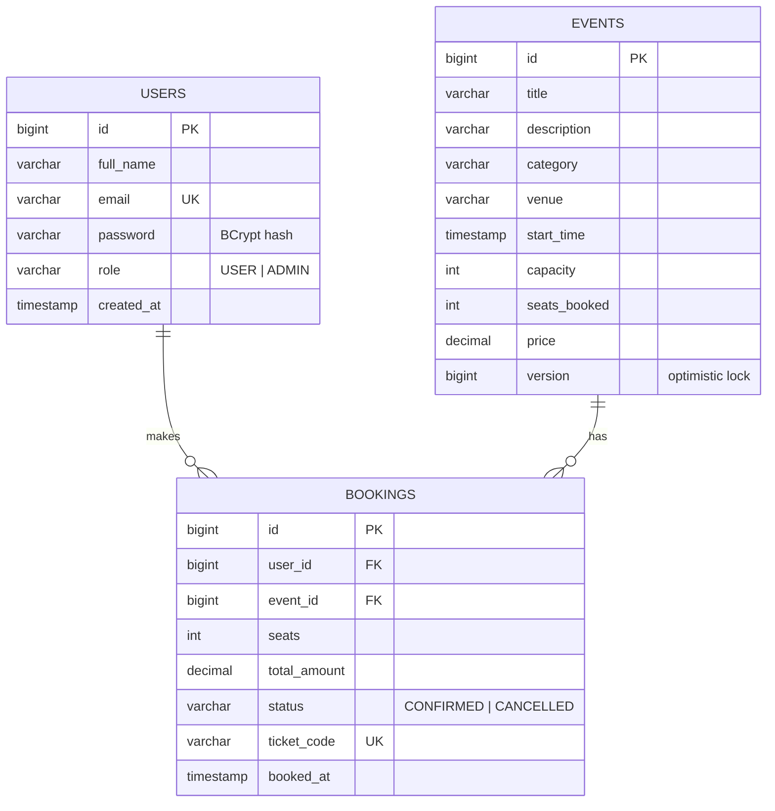

<div align="center">

# 🎟️ EventSphere

### Campus Event Management & Ticket Booking System

A full-stack **Spring Boot** web application where students discover and book campus events
and administrators create events and track attendance. It has a server-rendered web UI and a
secured REST API.

<p>
  
  
  
  
  
  
</p>

</div>

---

## 📖 About

Colleges run dozens of events every month: workshops, hackathons, fests, guest lectures and
sports. They are usually tracked with paper lists and messaging groups. **EventSphere** puts all of
them in one place:

- **Students** browse upcoming events, filter by category, book seats and get a unique ticket code.
- **Admins** create, edit and delete events, see who is attending, and follow bookings and revenue on a dashboard.

The project follows the standard **layered architecture** used in industry Spring applications
(Controller → Service → Repository → Database). It shows the core concepts of a Java / Spring Boot
course in a single working app.

---

## ✨ Features

| For students | For admins |
| --- | --- |
| Sign up and log in (passwords stored as BCrypt hashes) | Role-based admin area (`ROLE_ADMIN`) |
| Search events by title or venue and filter by category | Create, edit and delete events with full form validation |
| Live seat availability with an occupancy bar | Dashboard: total events, upcoming events, bookings, revenue |
| Book 1–10 seats and get a ticket code like `EVS-3F9A1C2B` | Attendee list for every event |
| "My tickets" page with one-click cancellation | Can't delete events that have bookings or shrink capacity below seats sold |

**Business rules enforced in the service layer:**

- An event can never be overbooked. Seat counts are checked, and `@Version` **optimistic locking** blocks race conditions when two people book the last seat at once.
- One active booking per user per event.
- Past events can't be booked, and bookings can't be cancelled after the event starts.
- Users can only see and cancel **their own** bookings.

---

## 🛠️ Tech Stack

| Layer | Technology |
| --- | --- |
| Language | Java 21 (records, text blocks, `var`, streams) |
| Framework | Spring Boot 4.1 (Spring Framework 7) |
| Web | Spring MVC, Thymeleaf, Bootstrap 5 |
| Security | Spring Security 7: form login, HTTP Basic for the API, BCrypt, role-based access |
| Persistence | Spring Data JPA / Hibernate |
| Database | H2 (in-memory, zero setup) or MySQL (`mysql` profile) |
| Validation | Jakarta Bean Validation (`@NotBlank`, `@Future`, `@Min`, …) |
| Testing | JUnit 5, Mockito, AssertJ, Spring MockMvc, Spring Security Test |
| Ops | Spring Boot Actuator, Docker, GitHub Actions CI |

---

## 🏗️ Architecture



Both the web UI and the REST API call the **same service classes**, so the business rules are
written once and behave the same everywhere.

### Database design



---

## 🚀 Getting Started

### Prerequisites
- **JDK 21** or newer. Maven is **not** needed because the project ships with the Maven Wrapper (`mvnw`).

### Run it

```bash
git clone https://github.com/Karthikx03/EventSphere.git
cd EventSphere
./mvnw spring-boot:run          # Windows: mvnw.cmd spring-boot:run
```

Open **http://localhost:8080**. The database is filled with sample events on startup.

### Demo accounts

| Role | Email | Password |
| --- | --- | --- |
| Admin | `admin@eventsphere.com` | `admin123` |
| Student | `student@eventsphere.com` | `student123` |

### Useful URLs

| URL | What |
| --- | --- |
| http://localhost:8080 | Home page |
| http://localhost:8080/admin | Admin dashboard (log in as admin) |
| http://localhost:8080/h2-console | Database console. JDBC URL `jdbc:h2:mem:eventsphere`, user `sa`, empty password |
| http://localhost:8080/actuator/health | Health check |

### Using MySQL instead of H2

```bash
export DB_URL="jdbc:mysql://localhost:3306/eventsphere?createDatabaseIfNotExist=true"
export DB_USERNAME=root
export DB_PASSWORD=your_password
./mvnw spring-boot:run -Dspring-boot.run.profiles=mysql
```

### Run in GitHub Codespaces (no local Java needed)

Click **Code → Codespaces → Create codespace on main**, the app starts by itself (or run `./mvnw spring-boot:run`).
Port 8080 opens automatically.

### Run with Docker

```bash
docker build -t eventsphere .
docker run -p 8080:8080 eventsphere
```

---

## 🔌 REST API

`GET` endpoints for events are public. Every other endpoint uses **HTTP Basic** authentication.
Errors come back as [RFC 9457 Problem Details](https://www.rfc-editor.org/rfc/rfc9457) JSON.

| Method | Endpoint | Access | Description |
| --- | --- | --- | --- |
| `GET` | `/api/events?q=&category=` | Public | List upcoming events (optional search and category filter) |
| `GET` | `/api/events/{id}` | Public | Get one event |
| `POST` | `/api/events` | Admin | Create an event |
| `PUT` | `/api/events/{id}` | Admin | Update an event |
| `DELETE` | `/api/events/{id}` | Admin | Delete an event (only if it has no bookings) |
| `GET` | `/api/bookings` | User | List my bookings |
| `POST` | `/api/bookings` | User | Book seats: `{"eventId": 1, "seats": 2}` |
| `POST` | `/api/bookings/{id}/cancel` | User | Cancel one of my bookings |

**Examples**

```bash
# list workshops
curl "http://localhost:8080/api/events?category=WORKSHOP"

# book 2 seats as the demo student
curl -u student@eventsphere.com:student123 -H "Content-Type: application/json" \
     -d '{"eventId": 1, "seats": 2}' http://localhost:8080/api/bookings

# create an event as admin
curl -u admin@eventsphere.com:admin123 -H "Content-Type: application/json" \
     -d '{"title":"Git Workshop","description":"Branching and PRs","category":"WORKSHOP","venue":"Lab 2","startTime":"2030-01-15T10:00:00","capacity":40,"price":0}' \
     http://localhost:8080/api/events
```

A validation error looks like this:

```json
{
  "type": "about:blank",
  "title": "Validation failed",
  "status": 400,
  "detail": "One or more fields are invalid",
  "errors": { "seats": "You can book at most 10 seats at once" }
}
```

---

## 📁 Project Structure

```
src/main/java/com/eventsphere
├── EventSphereApplication.java   # entry point
├── model/        # JPA entities: User, Event, Booking + enums
├── repository/   # Spring Data JPA interfaces (derived + JPQL queries)
├── dto/          # form objects and API request/response records
├── service/      # business logic and transactions
├── web/          # MVC controllers that return Thymeleaf views
├── api/          # REST controllers that return JSON
├── security/     # SecurityConfig, UserDetailsService
├── exception/    # custom exceptions + REST error handler
└── config/       # demo data seeder, shared model attributes
src/main/resources
├── templates/    # Thymeleaf pages (layout fragments, events, bookings, admin)
├── static/css/   # styling
└── application*.properties
src/test/java/com/eventsphere
├── service/BookingServiceTest.java   # unit tests with Mockito
└── api/ApiIntegrationTest.java       # full-stack tests with MockMvc + security
```

---

## 🧪 Testing

```bash
./mvnw test
```

- **Unit tests** (`BookingServiceTest`) check every booking rule in isolation with mocked repositories: overbooking, sold out, duplicates, past events, cancellation and ownership.
- **Integration tests** (`ApiIntegrationTest`) start the full Spring context with the H2 database and exercise the real security rules, controllers, validation and JSON responses.
- **GitHub Actions** runs the whole suite on every push.

---

## 🎓 Concepts Demonstrated

| Concept | Where to look |
| --- | --- |
| OOP: encapsulation, domain behaviour inside entities | `Event.reserveSeats()`, `Booking.cancel()` |
| Dependency Injection (constructor injection) | every `@Service` / `@Controller` |
| Layered architecture & separation of concerns | `web` / `api` → `service` → `repository` |
| ORM, entity relationships (`@ManyToOne`), enums | `model/` |
| Derived queries, JPQL, `join fetch` to avoid N+1 | `repository/` |
| Transactions (`@Transactional`) & optimistic locking (`@Version`) | `BookingService`, `Event` |
| Authentication, authorization, password hashing | `security/SecurityConfig` |
| Bean Validation & form error handling | `dto/EventForm`, `register.html` |
| Global exception handling (`@RestControllerAdvice`) | `exception/ApiExceptionHandler` |
| DTOs and Java records | `dto/EventResponse`, `dto/BookingRequest` |
| Profiles & externalised config | `application-mysql.properties` |
| Unit & integration testing | `src/test` |

---

## 🔮 Future Enhancements

- Email ticket confirmation with a QR code
- Payment gateway integration for paid events
- Event images and organiser profiles
- Waitlist that automatically fills seats freed by cancellations
- Pagination and sorting for large event lists
- JWT authentication for a separate mobile/SPA frontend

---

<div align="center">
Made with ☕ and Spring Boot as a Java course project.
</div>
